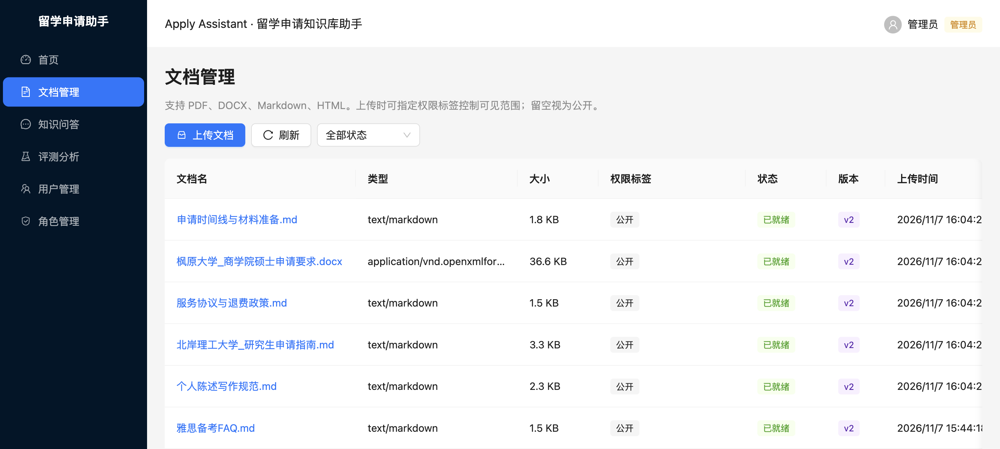
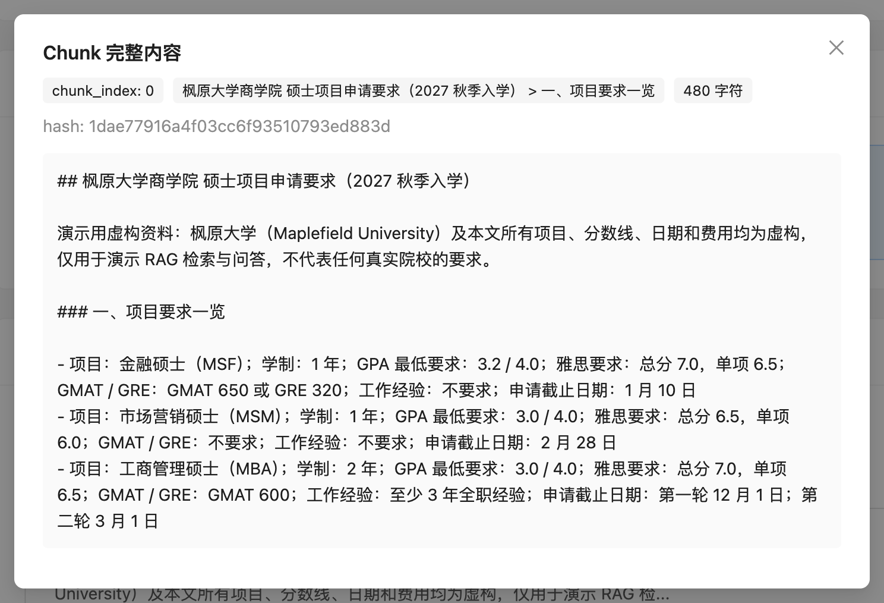
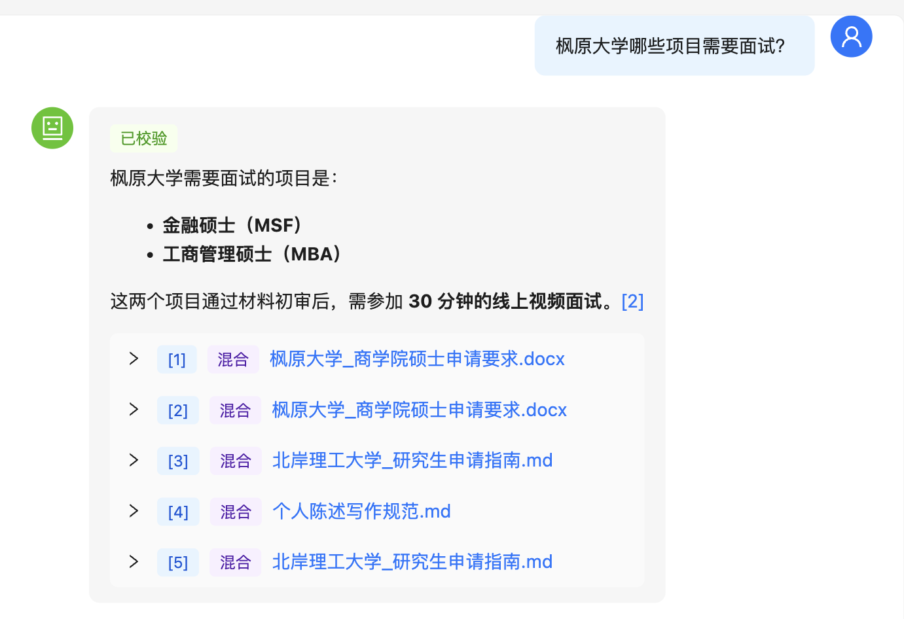
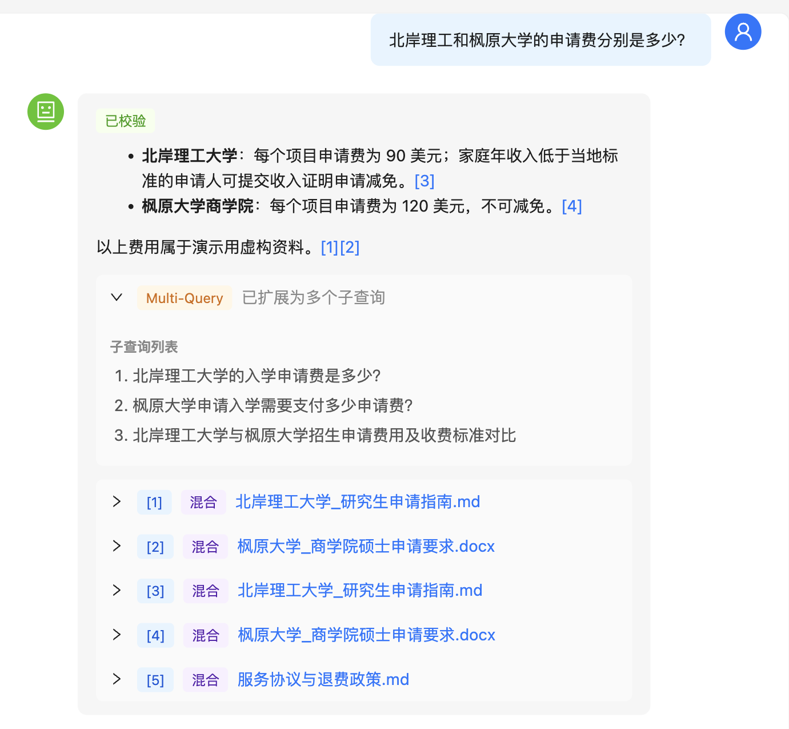
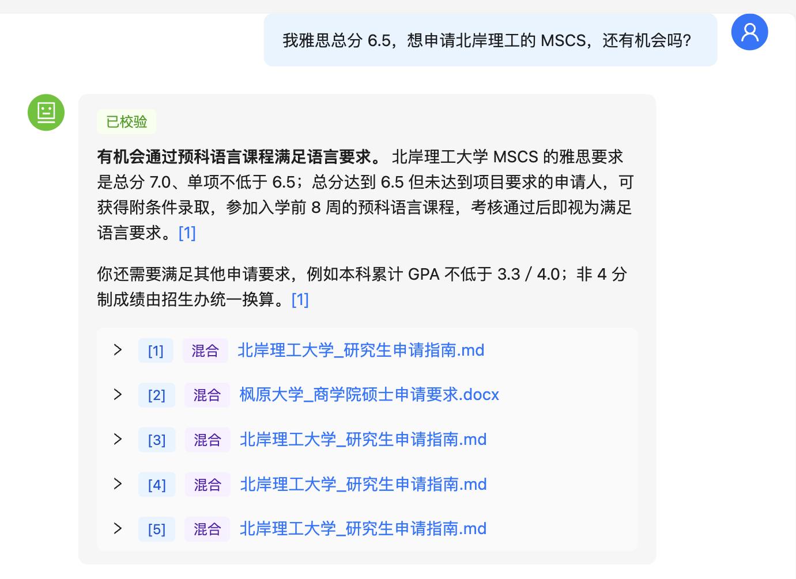
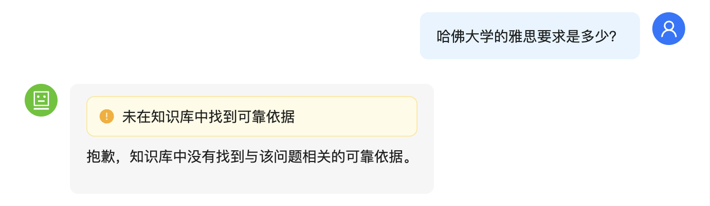
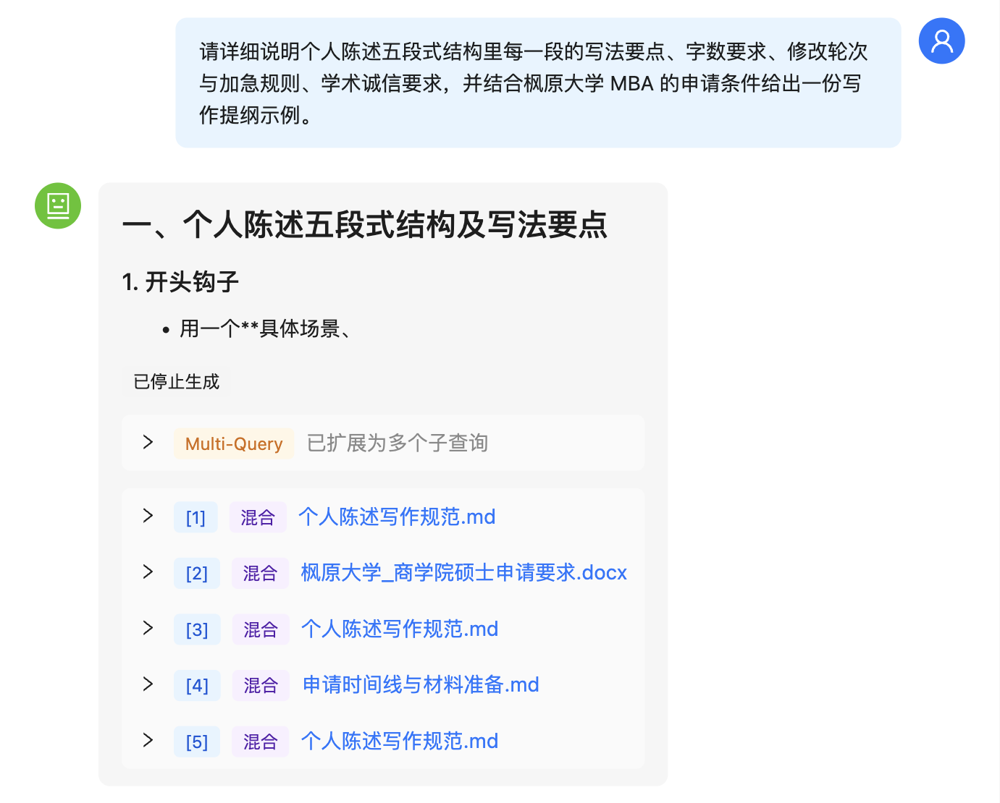
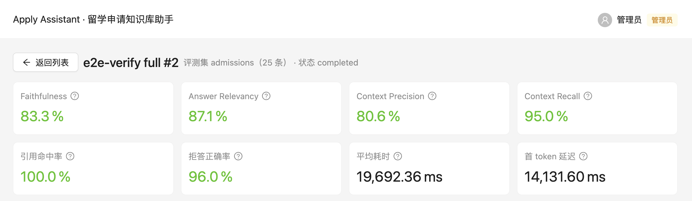
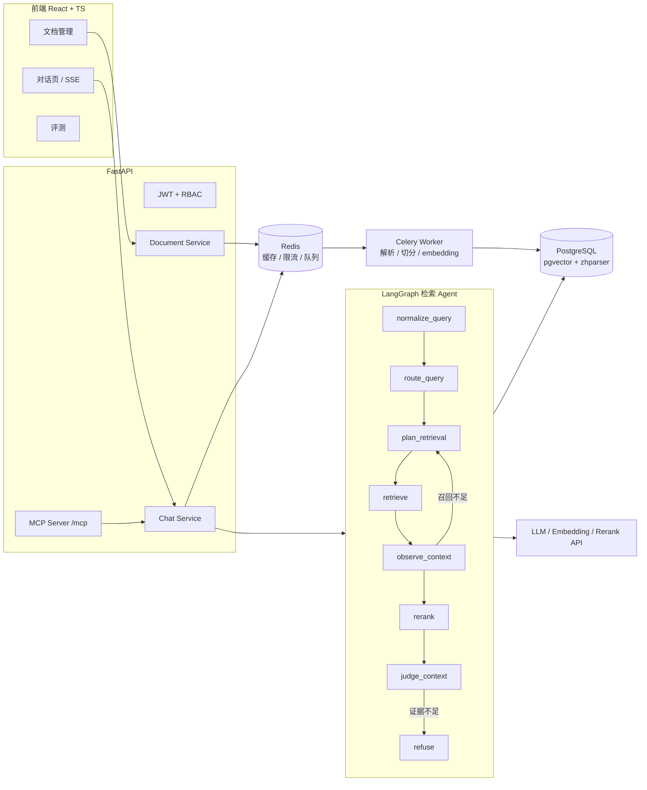

# Apply Assistant · 留学申请知识库助手

[](https://github.com/junqiangyuan/apply-assistant-rag/actions/workflows/ci.yml)


以**留学申请咨询**为场景的 Agentic RAG 知识库，覆盖从文档入库、混合检索、Agent 编排、流式对话，到评测、可观测性、权限和 MCP 能力开放的完整链路。前后端均由本人独立开发。

> An end-to-end Agentic RAG knowledge base for study-abroad application Q&A: document ingestion, hybrid retrieval with RRF and reranking, a LangGraph retrieval agent with bounded self-correction, SSE streaming chat, RAGAS-based evaluation, LangSmith tracing, RBAC with document-level permissions, and an MCP server. Backend: Python + FastAPI. Frontend: React + TypeScript.

> ⚠️ `sample_data/` 中的院校、机构、分数线、费用与日期**全部为虚构**，仅用于演示检索与问答，不代表任何真实院校或机构。

- 在线演示：[待补充]
- 截图：见下方「截图」一节；端到端验证过程见 [docs/verification-report.md](docs/verification-report.md)

## 截图

| 文档入库（6 份样例资料） | Word 表格转为键值对后的 chunk |
| --- | --- |
|  |  |

| 表格问答 | 跨文档问答（Multi-Query） |
| --- | --- |
|  |  |

| 条件推理 | 知识库外问题拒答 |
| --- | --- |
|  |  |

| 生成中停止 | 评测结果 |
| --- | --- |
|  |  |

## 功能

| 模块 | 能力 |
| --- | --- |
| 文档入库 | PDF / Word / Markdown 解析（Docling）、表格转写、清洗、分段、embedding；Celery 异步任务；按 `chunk_hash` 增量重建索引 |
| 检索 | pgvector 向量检索 + PostgreSQL zhparser 中文全文检索，RRF 融合；可开关的 Reranker 精排 |
| Agent | LangGraph 编排：查询规范化 → 路由 → 检索规划 → 检索 → 观察上下文（不足则回到规划重试，最多 3 轮）→ 精排 → 上下文判定 → 生成 / 拒答 |
| 对话 | SSE 流式输出、检索路由与 Agent 轮次面板、引用来源、多轮上下文化改写、可随时中断生成 |
| 可信度 | 答案引用校验（answer verifier），证据不足时主动拒答 |
| 评测 | 测评集管理、RAGAS 指标、Bad Case 归因分类、评测运行历史 |
| 可观测性 | LangSmith Trace，前端展示 trace_id 并可跳转 |
| 权限 | JWT 认证、RBAC 角色、文档级 `permission_tags` 过滤，检索层只返回当前用户可见的片段 |
| 性能与成本 | Redis 语义缓存、滑动窗口限流 |
| 能力开放 | MCP Server（Streamable HTTP，挂载在 `/mcp`），复用同一套认证与权限过滤 |

## 架构



## 技术栈

- **后端**：Python 3.11、FastAPI、SQLAlchemy（async）+ Alembic、LangGraph、LangChain、Celery、Docling
- **存储**：PostgreSQL 16（pgvector + zhparser）、Redis Stack、腾讯云 COS（原始文件）
- **模型**：OpenAI 兼容接口（默认 DashScope：qwen-plus、text-embedding-v3、qwen3-rerank），可替换
- **前端**：React 19、TypeScript、Vite、Ant Design、TanStack Query、Zustand，接口类型由 OpenAPI 自动生成
- **工程**：uv、pytest、ESLint、GitHub Actions CI、Docker Compose

## 快速开始

```bash
# 1. 启动 PostgreSQL 与 Redis
cp .env.example .env          # 填写模型 API Key、COS 配置，并修改默认管理员密码
docker compose up -d

# 2. 后端
cd backend
uv sync
uv run alembic upgrade head
uv run uvicorn app.main:app --reload --port 8000
uv run celery -A app.celery_app worker -l info   # 另开终端

# 3. 前端
cd frontend
npm ci
npm run dev                    # http://localhost:5173
```

首次启动会按 `.env` 中的 `DEFAULT_ADMIN_*` 创建管理员账号。**部署到公网前务必修改默认密码。**

## 样例数据与评测

- `sample_data/docs/`：6 份虚构资料，包含院校申请指南、商学院项目要求（Word 表格，用于验证表格解析）、文书规范、雅思 FAQ、申请时间线、服务与退费政策。登录后在「文档管理」上传即可。
- `backend/app/evaluation/datasets/admissions.jsonl`：25 条测评用例，覆盖事实问答、表格问答、跨文档对比、条件推理和应拒答问题；`admissions_smoke.jsonl` 为 5 条冒烟集。
- 在「评测」页选择测评集运行，查看 RAGAS 指标与 Bad Case 归因。

### 评测结果

`admissions`（25 条）在本地的一次完整运行（2026-11-07，详见 [验证报告](docs/verification-report.md)）：

| 引用命中率 | 拒答正确率 | Faithfulness | Answer Relevancy | Context Precision | Context Recall | 平均耗时 | 首 token 延迟 |
| --- | --- | --- | --- | --- | --- | --- | --- |
| 100%（22/22） | 96%（24/25） | 0.833 | 0.871 | 0.806 | 0.950 | 19.7 s | 14.1 s |

配置：`CHAT_MODEL=gpt-6.1-terra`（生成与 RAGAS 评判共用）、`text-embedding-v3`、`RERANK_ENABLED=False`、`VERIFY_ANSWER_ENABLED=True`、`RETRIEVAL_TOP_K=5`、`RETRIEVAL_RECALL_TOP_K=20`、`RETRIEVAL_MIN_SCORE=0.6`、`RERANK_MIN_SCORE=0.3`、`CHUNK_SIZE=600`、`AGENT_MAX_ROUNDS=3`，RAGAS 0.4.3。

说明：

- 四项 RAGAS 指标是对返回有效值的样本取平均，有效样本数依次为 14 / 8 / 14 / 20，波动较大；引用命中率和拒答正确率由规则计算，覆盖全部用例。
- 唯一未通过的用例是 case_025（“帮我预测能不能被录取”）：系统没有拒答，而是说明无法预测，并列出了申请要求。

## 设计取舍

- **单实例 PostgreSQL 承担向量 + 全文检索**：pgvector 与 zhparser 在同一个库里，两路召回不用跨服务对齐，部署只需要一个数据库。代价是向量规模变大后需要再评估专用向量库。
- **RRF 融合而不是分数加权**：向量相似度和全文检索分数量纲不同，RRF 只看排名，免去归一化调参。
- **Reranker、答案校验都做成开关**：`RERANK_ENABLED`、`VERIFY_ANSWER_ENABLED` 可单独关闭，方便用同一测评集对比"有 / 无"的效果与延迟，而不是凭感觉判断收益。
- **Agent 循环有上限**：`observe_context` 判断召回不足时回到 `plan_retrieval` 改写重试，但总轮数受 `AGENT_MAX_ROUNDS` 限制（默认 3 轮），到达上限后停止重试、进入精排与判定，避免无限循环和成本失控。
- **宁可拒答，不编答案**：检索分数低于阈值、精排分过低、上下文判定不足时都会走 `refuse` 节点。
- **入库异步 + 增量**：上传后由 Celery 执行，任务状态落库可重试；重新索引按 `chunk_hash` 只为变化的片段重算 embedding。
- **MCP 复用同一套权限**：外部 Agent 通过 MCP 调用时，同样经过 JWT 认证和文档级权限过滤，不能绕过知识库权限。

## 项目结构

```text
backend/app/
├── api/            # 路由、请求响应模型、依赖注入
├── workflows/      # LangGraph 检索 Agent（graph.py + nodes/）
├── retrieval/      # 向量 / 关键词 / 混合检索
├── ingestion/      # 解析、切分、embedding、Celery 任务
├── llm/            # Prompt、查询改写、重排、答案校验
├── evaluation/     # 测评集与 RAGAS 评测
├── mcp_server/     # MCP Server 工具定义与鉴权
├── services/       # 业务服务层
├── db/             # ORM 模型、仓储、初始化数据
└── sql_agent/      # NL2SQL 实验模块（语义层 + sqlglot 校验）
frontend/src/       # 页面、组件、状态、自动生成的 API Client
sample_data/        # 虚构演示资料
deploy/             # Nginx 与 systemd 部署配置示例
```

## 已知限制与后续计划

- 原始文件存储依赖腾讯云 COS，计划增加本地文件存储选项，降低本地运行门槛
- 计划新增「选校助手」：学生档案长期记忆（结构化存储 + 冲突处理）+ 院校查询工具 + 结构化推荐输出
- 前端计划补充「重新生成」与历史版本切换

## 开发历程

本项目最初是我从 Java 后端转向 Python AI 应用开发时的个人原型，按"文档向量化 → 问答 → 查询优化与混合检索 → Agentic 重试 → 精排与答案校验 → 可观测性 → 评测 → 权限 → 缓存与异步 → MCP → 部署"逐步迭代完成。本仓库是整理后的公开版本，并将场景改为留学申请咨询。

## License

[MIT](LICENSE)
